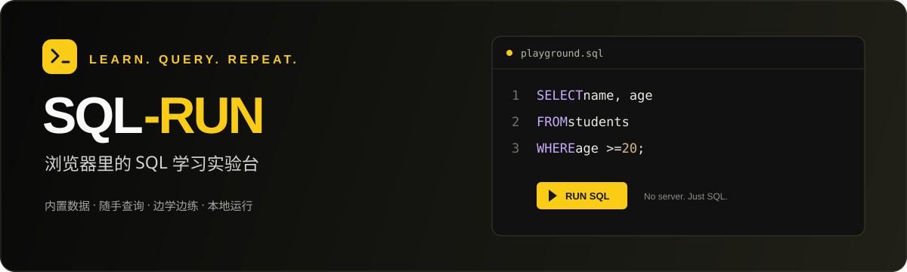

<div align="center">



# SQL-RUN

**打开即练，把想法写成 SQL。**

一个轻量的纯前端 SQL 学习实验台。无需后台、无需登录、无需安装数据库服务。

在浏览器里查看表结构、编写查询、阅读教程，再用自己的数据继续实验。

[](https://react.dev/)
[](https://www.typescriptlang.org/)
[](https://vite.dev/)
[](https://sql.js.org/)
[](LICENSE)

[快速开始](#快速开始) · [功能一览](#功能一览) · [导入自己的表](#导入自己的表) · [兼容范围](#sql-兼容范围) · [参与贡献](#参与贡献)

</div>

---

## 为什么做 SQL-RUN

学 SQL 时，最有帮助的往往是立即执行一条语句，看看数据究竟发生了什么。

SQL-RUN 将数据、教程、练习和编辑器放在一起，省去搭建服务和准备数据的步骤。你可以从第一条 `SELECT` 开始，逐步练习多表关联、统计分析、事务和窗口函数，也可以导入自己的表结构进行实验。

> **执行引擎说明：** SQL-RUN 使用 sql.js（SQLite WebAssembly），适合学习通用 SQL。MySQL 专有语法、类型规则和并发行为需要在真实 MySQL 环境中验证，详见[兼容范围](#sql-兼容范围)。

## 功能一览

| | 功能 | 你可以做什么 |
| :---: | --- | --- |
| ⌨️ | SQL 实验台 | 语法高亮、表名与字段补全，选中执行或运行全部 SQL |
| 📊 | 执行结果 | 查看多语句结果与失败位置，复制单元格或整表、导出 CSV |
| 🗂️ | 表结构浏览 | 搜索表名、全部收起，查看非空、默认值、外键及注释，点击字段插入编辑器 |
| 📖 | 学习文档 | 12 篇教程，含学习目标、章节导航、语法对照表、结果解读和巩固练习，支持全文搜索与示例载入 |
| ✍️ | 配套练习 | 20 道练习，18 道查询题支持独立默认库结果校验，保留自主标记掌握 |
| 📥 | 数据导入 | 上传 `.sql` 文件或粘贴建表与初始化语句，创建自己的实验环境 |
| 💾 | 实验库备份 | IndexedDB 自动保存，默认库与自定义库独立切换，导出及恢复 SQLite 备份 |
| 🕘 | 本地记录 | 最近 30 次执行记录含状态、耗时和所属库；最多 100 条 SQL 收藏，支持搜索与下载 |
| 🌗 | 黑黄主题 | 支持浅色与深色模式、系统主题跟随和移动端布局 |

SQL 在 Web Worker 中执行，页面保持响应；支持手动停止、执行超时恢复和一键重置实验数据。

## 快速开始

### 环境准备

- Node.js **20.19+** 或 **22.12+**。
- 推荐使用 pnpm，项目声明版本为 **10.11.0**。

### 本地启动

```bash
git clone https://github.com/qiaojianfeng/sql-run.git
cd sql-run
pnpm install
pnpm dev
```

打开终端输出的本地地址。默认端口为 `5173`，端口被占用时 Vite 会自动选择下一个可用端口。

<details>
<summary>使用 npm 启动</summary>

```bash
npm install
npm run dev
```

仓库维护 pnpm 锁文件，提交依赖变更时请使用 pnpm。

</details>

首次安装需要联网下载依赖。安装完成后，应用代码、WASM 和默认数据均由本地项目提供，SQL 执行不依赖远程接口或 CDN。

### 开始第一次实验

1. 在左侧展开 `students`，查看字段类型和中文注释。
2. 在编辑器中输入以下查询。
3. 点击「运行 SQL」，或在编辑器内按 **Ctrl + Enter / ⌘ + Enter**。
4. 从顶部打开「SQL 学习文档」，或使用实验台内的「学习练习」，继续探索。

```sql
SELECT name AS 姓名, age AS 年龄, class_name AS 班级
FROM students
WHERE age >= 20
ORDER BY age DESC, id ASC;
```

选中部分 SQL 时只执行选中内容；没有选区时执行全部内容。多条语句按顺序执行，结果分别展示。

选中后按钮显示「运行选中内容」。语句失败时会显示编号和对应 SQL；解析失败时展示失败位置起的 SQL，并注明可能包含后续未执行内容。编辑内容未变化时，可点击「定位到编辑器」。

结果支持单元格复制、整表复制（TSV）和 CSV 下载，均仅包含当前已展示内容；CSV 以 UTF-8 BOM 编码导出。空值使用 `NULL` 文本表示，公式形式的文本会添加单引号以便表格软件按普通文本处理。界面分别提示「查询无数据」和「结果已截断」。

查询练习的「验证当前 SQL 结果」在独立 Worker 内使用全新的默认学生库，不依赖或修改当前实验库。接受一条 `SELECT` / `WITH` 查询，按结果内容、列顺序、重复项及空值比较，列别名不限；第 4、5 题额外检查输出行顺序。校验结果用于当前固定数据集的练习反馈，不代表任意数据集上都等价；修改与事务题仍参照答案自主验证。

## 内置实验数据

默认场景是学生成绩库，关系简单，适合观察不同 SQL 的结果。

| 数据表 | 内容 | 默认记录数 |
| --- | --- | ---: |
| `students` | 学生姓名、年龄、班级、城市与入学日期 | 12 |
| `courses` | 课程名称、教师与学分 | 5 |
| `scores` | 学生课程成绩与考试日期 | 26 |

```text
students.id ──── scores.student_id
courses.id  ──── scores.course_id
```

数据特意保留了空值、并列成绩、没有成绩的学生，以及没有成绩记录的课程，可用于练习 `NULL`、`LEFT JOIN`、`NOT EXISTS` 和排名函数。3 张表的全部 16 个字段均有中文说明。

## 导入自己的表

打开顶部「导入数据表」，选择 UTF-8 编码的 `.sql` 文件、本站导出的 `.sqlite` / `.db` 备份，或直接粘贴 SQL。确认内容后，点击「导入并替换自定义库」。

```sql
CREATE TABLE books (
  id INTEGER PRIMARY KEY,
  title TEXT NOT NULL,
  price DECIMAL(10, 2)
);

INSERT INTO books (id, title, price)
VALUES (1, 'SQL 入门', 39.90), (2, '数据库原理', 59.00);
```

- **先验证，再替换：** 在独立 Worker 中执行脚本或校验备份；导入成功后替换自定义实验库，默认学习库保留，失败或超时保留原环境。已有自定义库时请先导出备份。
- **容量限制：** SQL 文件最大 2 MB，最多 2,000 条语句；SQLite 备份最大 20 MB，导入超时均为 15 秒。
- **语法要求：** 脚本需要包含建表语句，并兼容 SQLite。MySQL dump 中的 `ENGINE`、`CHARSET`、`AUTO_INCREMENT`、`SET`、`USE` 等内容需要自行调整，当前不提供自动转换。
- **本地保存：** 默认学习库与自定义实验库分别自动保存在 IndexedDB。刷新恢复最近提交快照；停止或超时恢复执行前的最近提交快照，本次执行及未提交事务会丢弃。

导入自定义库后，练习区域显示「需要默认学习库」。点击「切换学习库」即可练习，点击「返回自定义库」继续自己的实验；两个库分别保留。文档示例也会提示先切换学习库。

点击数据集旁的「导出备份」下载 `.sqlite` 文件，可通过导入功能恢复。重置仅重建默认学习库，不删除自定义实验库。

载入教程、练习、表查询或历史 SQL 时，可选择「插入光标处」或「备份并替换内容」。两种操作均支持 Ctrl / ⌘ + Z 撤销，编辑器也提供「恢复上份草稿」。点击左上角品牌只返回实验台，不刷新页面。

## SQL 兼容范围

| 能力 | 支持说明 |
| --- | --- |
| 基础查询 | `SELECT`、`WHERE`、排序、分页、去重与空值处理 |
| 关联与统计 | `JOIN`、聚合、`GROUP BY`、`HAVING`、子查询、`EXISTS` |
| 进阶查询 | CTE、窗口函数、`CASE` 等 SQLite 支持的语法 |
| 数据与结构 | SQLite 语法的增删改、建表、约束与索引 |
| 事务 | 显式 `BEGIN` / `COMMIT` / `ROLLBACK`，可以跨次运行 |
| MySQL 专项能力 | 不模拟存储过程、账号权限、InnoDB 锁、隔离级别和 MySQL 执行计划 |

MySQL 与 SQLite 在函数、类型约束、`GROUP BY`、DDL 和事务行为上存在差异。例如，MySQL 的 `DATE_FORMAT`、`AUTO_INCREMENT` 和字段 `COMMENT` 不能直接照搬到本工具中；内置字段注释使用本地元数据及 SQL 注释展示。

## 数据保存与执行规则

| 内容 | 保存位置 | 刷新后的行为 |
| --- | --- | --- |
| 默认学习库、自定义库的已提交数据及结构 | 浏览器 IndexedDB | 恢复最近快照与所选库 |
| 未提交事务、TEMP 表、连接级设置 | 当前标签页的 Worker 内存 | 不恢复 |
| 编辑内容、上份草稿、提交历史、SQL 收藏、学习进度 | 浏览器 `localStorage` | 保留 |
| 深浅模式选择 | 浏览器 `localStorage` | 保留；未手动选择时跟随系统 |

SQL 和导入文件均在浏览器内处理，无后台上传。本地保存依赖当前浏览器和站点地址；清除站点数据会删除快照与学习记录，重要实验请导出备份。保存失败会显示提示。

不同标签页各有独立执行引擎，但同源的 IndexedDB 与学习记录共享，最近一次保存会覆盖持久记录。建议同一站点只使用一个标签页进行数据库修改。

<details>
<summary>执行限制与事务说明</summary>

- 普通查询一次最多执行 **30 条语句**，SQL 最长 **50,000 个字符**，执行超时为 **5 秒**。
- 每个结果最多展示 **500 行**，字符串单元格最多展示 **4,000 个字符**；同时限制累计返回内容大小。
- 语句遇错后停止后续执行，之前已经生效的修改不会自动撤销。
- 显式事务执行到一半发生错误时，请手动执行 `ROLLBACK`，或重置实验库。
- 停止和超时通过销毁 Worker 实现，恢复最近提交快照；本次运行中的所有修改和未提交事务会丢弃。
- 未结束的事务暂停快照保存、库切换和备份导出。提交或回滚后恢复保存；TEMP 表及连接级设置不包含在快照中。
- 学习进度由用户自主标记，查询题可先运行独立结果校验；校验不自动标记掌握。

</details>

## 开发与部署

| 命令 | 用途 |
| --- | --- |
| `pnpm dev` | 启动本地开发服务器 |
| `pnpm typecheck` | TypeScript 类型检查 |
| `pnpm test` | SQL 引擎与错误位置、导入、快照与事务、练习校验、结果导出、记录兼容、快捷键与草稿撤销测试 |
| `pnpm build` | 类型检查并生成静态产物 `dist/` |
| `pnpm preview` | 在本地预览构建产物 |

部署时运行 `pnpm build`，将 `dist/` 发布到支持静态文件的 HTTP 服务即可。构建使用相对资源路径，部署时应保留生成的 JavaScript 与 WASM 文件。请通过 HTTP 服务访问，不能直接双击 `index.html` 使用。

## 项目结构

```text
sql-run/
├── docs/assets/        README 品牌图
├── src/
│   ├── components/    实验台、编辑器、文档、导入弹窗等组件
│   ├── data/          默认数据、字段说明、练习与教程
│   ├── database/      SQL 引擎、Web Worker、导入与测试
│   ├── hooks/         数据库生命周期、本地存储与主题
│   ├── App.tsx        页面布局与菜单切换
│   ├── theme.css      浅色与深色主题变量
│   ├── styles.css     实验台与公共样式
│   └── docs.css       学习文档与代码卡片样式
├── index.html
├── package.json
└── vite.config.ts
```

想扩充学习内容，可以从这些文件开始：

| 文件 | 修改内容 |
| --- | --- |
| [`src/data/dataset.ts`](src/data/dataset.ts) | 默认建表 SQL、初始化数据和字段注释 |
| [`src/data/exercises.ts`](src/data/exercises.ts) | 练习题、提示与参考答案 |
| [`src/data/lessons.ts`](src/data/lessons.ts) | 学习文档及可执行示例 |
| [`src/data/lessonDetails.ts`](src/data/lessonDetails.ts) | 教程的延伸讲解、速查表、结果解读与动手任务 |
| [`src/theme.css`](src/theme.css) | 全站主题颜色 |

## 参与贡献

欢迎提交问题、修正文档、补充练习或改进交互。

- **反馈问题：** 在 [Issues](https://github.com/qiaojianfeng/sql-run/issues) 中描述复现步骤、浏览器版本、相关 SQL 及预期结果。提交 SQL 前请移除个人或业务敏感数据。
- **提出改进：** 较大功能建议先通过 Issue 讨论范围，再开始实现。
- **提交代码：** Fork 仓库并创建分支，保持改动聚焦；使用 pnpm 更新依赖和锁文件，提交前运行 `pnpm typecheck` 与相关测试。涉及界面调整时，请附上深浅模式截图。
- **补充内容：** 新增练习应提供提示和可运行答案；教程中涉及 MySQL 特有行为时，请明确兼容边界。
- **编写教程：** 在正文、列表和表格中用反引号标记 SQL 关键字、字段或表达式，页面会显示为行内代码；段落之间用两个换行分隔。请同步补充学习目标、结果解读和巩固任务，并确认示例可在默认学习库运行。

## 致谢

SQL-RUN 基于 [React](https://react.dev/)、[Vite](https://vite.dev/)、[CodeMirror](https://codemirror.net/)、[sql.js](https://sql.js.org/) 和 [Lucide](https://lucide.dev/) 构建。

## 许可证

本项目采用 [MIT 许可证](LICENSE)。允许个人及商业使用、修改和分发，使用时请保留原版权声明与许可证文本。

---

<div align="center">

**保持好奇，慢慢进步。**

如果 SQL-RUN 对你有帮助，欢迎通过 [Issue](https://github.com/qiaojianfeng/sql-run/issues) 分享建议，也欢迎给项目一个 Star。

</div>
